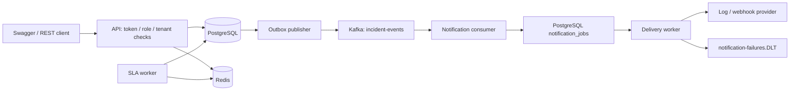

# Design and tradeoffs

One repository, one deployable JAR, three process profiles. API runs the outbox publisher;
notification-worker runs the consumer and job dispatcher; escalation-worker checks acknowledgment SLAs.
All share PostgreSQL. This is not a set of independent microservice databases.

## Source ownership

`incident/api` adapts HTTP and takes identity from the authenticated principal.
`incident/application` owns use-case transactions; `incident/domain` enforces lifecycle rules.
`incident/persistence` holds Spring Data repositories. `events`, `notifications`, `escalation`,
`redis`, and `security` isolate the new capabilities. Clock injection keeps time-dependent tests possible.

## Database and transactions

V1 tables remain. V2 adds `notification_jobs` and `worker_locks`, `request_hash` to idempotency records,
and `sla_due_at` / `escalated_at` to incidents. Creation and transitions persist audit and outbox
entries in the same transaction. JPA versions detect overlapping updates. Creation's transaction
includes the unique idempotency row; a losing create rolls back and reads the winning row.

The outbox publisher claims a singleton PostgreSQL row with `FOR UPDATE SKIP LOCKED`. One publisher
drains a batch ordered by creation time and UUID; this avoids simultaneous publishers reordering
batches. It waits for broker acknowledgement, then marks rows published. A crash after broker
acknowledgement can replay already-sent events. Consumer offsets commit after the database job insert.

No claim of globally ordered wall-clock events or exactly-once external delivery is made. For a
larger system use a per-aggregate sequence/CDC outbox, shard publication locks, and measure throughput.
Batch size is 20 and every unconfirmed send rolls back the batch.

Delivery workers use `FOR UPDATE SKIP LOCKED` on one job while calling a bounded-time provider.
This deliberately holds a database connection for simplicity. At scale, replace it with persisted
leases plus fencing. A completed delivery is not retried, and exhausted attempts never call the
provider again, even while DLT publishing fails.

## Topics and keys

| Topic | Key | Purpose |
| --- | --- | --- |
| incident-events | Incident UUID | schemaVersion=1 incident envelopes |
| incident-events.DLT | Original incident key | Consumer processing/deserialization failures |
| notification-failures.DLT | Incident UUID | Provider retries exhausted; original envelope |

Each topic has 3 partitions and replication factor 1 in the local demo. Notification group is
`signaldesk-notifications-v1`, concurrency 3. Every envelope carries a stable event UUID,
incident UUID, tenant, type, status, severity, assignee, timestamp and correlation ID.
No Java object deserialization is used. JSON is validated before job creation.

## Redis keys

Tenant and user components are Base64URL encoded to avoid delimiter collisions.

| Key | Lifetime | Failure policy |
| --- | --- | --- |
| sd:incident:TENANT:UUID:vVERSION | 60 seconds | Database fallback |
| sd:rate:TENANT:USER | 60 seconds from first request | Allow request; record failure metric |
| sd:lock:sla-scan | 30 seconds | Skip scan; try next scheduled run |

Rate counting and expiry are atomic Lua operations. Lock release compares an ownership token
before deleting the key. SLA database row locks + a persistent escalation marker remain authoritative
if the Redis lease expires. Versioned cache keys and a database version check prevent old data from
being read after an update, including concurrent cache fills. This trades a small DB read for correctness.
Old entries expire even if invalidation fails. Idempotency stays durable in PostgreSQL rather than Redis.

## Observability

`X-Correlation-Id` is validated/generated, returned to the client and stored in the event envelope.
JSON logs include the correlation context during HTTP work and notification delivery.
Metrics include `signaldesk.outbox.published/failure`, `signaldesk.consumer.accepted/duplicate`,
`signaldesk.notification.sent/failure/dead`, `signaldesk.escalation.created`,
`signaldesk.cache.hit/miss`, `signaldesk.redis.failure`, and standard HTTP/JVM metrics.
Use readiness for DB readiness; cache/broker failures should not take incident writes offline.

## Capacity worksheet (assumptions, not measured results)

For 10,000 incidents/day and 4 events each: 40,000 events/day is about 0.46 events/second on average.
At 1 KB/event, raw event payloads are about 40 MB/day; indexes, WAL and broker overhead add more.
Seven days of broker retention needs at least 280 MB before replication and overhead. The current
one-job-at-a-time delivery loop, provider latency and database-lock publisher will become bottlenecks
well before Kafka. Load-test with real payloads/providers before picking limits. Archive published
outbox rows and completed jobs deliberately; this starter does not delete audit history automatically.

## Reference decisions

- [Spring Kafka error handling](https://docs.spring.io/spring-kafka/reference/kafka/annotation-error-handling.html): bounded retry + DLT publication confirmation.
- [Redis ownership-token locks](https://redis.io/docs/latest/develop/clients/patterns/distributed-locks/): compare-before-delete release, database backstop.
- [Apache Kafka 3.9 container definition](https://github.com/apache/kafka/blob/3.9.0/docker/jvm/Dockerfile): persist broker logs in the image's writable `/var/lib/kafka/data` directory.
